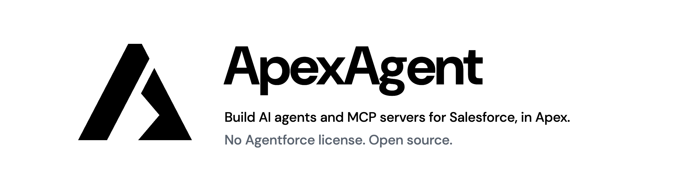

# ApexAgent

<p align="center">
  <picture>
    <source media="(prefers-color-scheme: dark)" srcset="assets/banner-dark.png">
    
  </picture>
</p>

**[Documentation](https://badrisnarayanan.github.io/ApexAgent/)** · [Install](https://badrisnarayanan.github.io/ApexAgent/start/install/) · [Agent](https://badrisnarayanan.github.io/ApexAgent/agent/setup/) · [MCP server](https://badrisnarayanan.github.io/ApexAgent/mcp/setup/) · [Tools](https://badrisnarayanan.github.io/ApexAgent/tools/built-in/)

> 💡 **No extra Salesforce licensing.** ApexAgent uses only standard platform features: Apex, custom objects, Lightning Web Components and a Salesforce Site. It needs **no Agentforce license, no Einstein add-on and no Data Cloud**. It runs in Developer, Enterprise, Performance and Unlimited Edition orgs.
>
> **The agent:** its running cost is the AI model. You pay your model provider directly for what you use, and ApexAgent adds nothing. The agent runs inside your org and calls the model from Apex; it doesn't connect to Salesforce as an outside AI client.
>
> **The MCP server:** it brings no model of its own; the model belongs to the client that connects, such as Claude or ChatGPT. Each request uses one of your org's ordinary API requests today. Salesforce has [announced](https://help.salesforce.com/s/articleView?language=en_US&id=005360285&type=1) that calls from outside AI agents like these, over MCP or the API, will be billed in Flex Credits once it sets a rate, and that would apply to MCP calls here too.

Everything deploys into your org and runs with your users' own permissions. There is no middleware and no external server to host.

ApexAgent gives you two things. They draw on the same set of tools, and you can use either one without the other.

| | 🤖 Agent | 🔌 MCP Server |
| --- | --- | --- |
| **What it is** | A chat assistant inside Salesforce, in the utility bar | An endpoint in your org that lets an outside AI client (Claude, ChatGPT, or any MCP client) use Salesforce tools |
| **Where the AI model runs** | Called from Apex, at any OpenAI-compatible provider | In the client you connect. ApexAgent never calls a model. |
| **Extra Salesforce license** | **None** | **None** |
| **Who pays for the model** | You, through your account with the model provider | Whoever runs the client |
| **Needs a model provider API key** | **Yes**. OpenRouter comes preconfigured, or use your own | **No** |
| **Needs an External Client App**, Salesforce's newer form of a Connected App | No | **Yes**. The deploy creates it |
| **Users sign in with** | Nothing extra; they are already in Salesforce | Their own Salesforce login, from the client |

## Quick start

You need the [Salesforce CLI](https://developer.salesforce.com/tools/salesforcecli), Git, and an org where you are a System Administrator. See the full [prerequisites](https://badrisnarayanan.github.io/ApexAgent/start/prerequisites/).

```bash
git clone https://github.com/badrisnarayanan/ApexAgent.git
cd ApexAgent
sf org login web --alias my-org --set-default
sf project deploy start --source-dir force-app
sf apex run --file seed/setup.apex
```

Setup creates a starter configuration: 4 model providers, 5 LLMs, 10 tools, 1 agent (Lumen) and 1 MCP server. Then follow the [install guide](https://badrisnarayanan.github.io/ApexAgent/start/install/) to give your users access and finish the part you want:

- 🔌 [Set up the MCP server](https://badrisnarayanan.github.io/ApexAgent/mcp/setup/) and [connect a client](https://badrisnarayanan.github.io/ApexAgent/mcp/setup/#3-connect-your-client) such as Claude or ChatGPT
- 🤖 [Set up the agent](https://badrisnarayanan.github.io/ApexAgent/agent/setup/)

## What's included

- **[Ten built-in tools](https://badrisnarayanan.github.io/ApexAgent/tools/built-in/)** for finding objects, reading and searching records, running SOQL queries and saving changes. Every tool that touches records runs as the signed-in user.
- **ApexAgent Setup Portal**: a Lightning app for managing LLMs, agents, topics, instructions, tools and MCP servers.
- **Logs** of every conversation, message, tool call and error, with [reports and dashboards](https://badrisnarayanan.github.io/ApexAgent/operate/logs/).
- **A setup script** that creates a working starter configuration.

## Documentation

| | |
| --- | --- |
| [ApexAgent agent vs Agentforce](https://badrisnarayanan.github.io/ApexAgent/start/compare/agent/) | What each is, what each costs, when to choose which |
| [ApexAgent MCP server vs Salesforce Hosted MCP Servers](https://badrisnarayanan.github.io/ApexAgent/start/compare/mcp/) | The same comparison for the MCP server |
| [Security and data](https://badrisnarayanan.github.io/ApexAgent/operate/security/) | Who sees what, what reaches a model, and where data goes |
| [Add your own tool](https://badrisnarayanan.github.io/ApexAgent/tools/add-a-tool/) | Write one Apex class and give it to an agent, an MCP server, or both |
| [Change the model](https://badrisnarayanan.github.io/ApexAgent/agent/models/) | Switch the agent to another model |
| [Built-in providers](https://badrisnarayanan.github.io/ApexAgent/agent/providers/) | OpenRouter, OpenAI, Azure OpenAI and Google AI Studio |
| [Connect a gateway](https://badrisnarayanan.github.io/ApexAgent/agent/gateway/) | Your company's AI gateway or any OpenAI-compatible service |
| [MCP limits](https://badrisnarayanan.github.io/ApexAgent/mcp/limits/) | The Salesforce limits that apply, and how to watch them |
| [How it's organised](https://badrisnarayanan.github.io/ApexAgent/project/organisation/) | The records that make up an agent and an MCP server |
| [Troubleshooting](https://badrisnarayanan.github.io/ApexAgent/operate/troubleshooting/) | Fixes for common setup and sign-in problems |
| [Contributing](https://badrisnarayanan.github.io/ApexAgent/project/contributing/) | Repository layout, tests, and the starter configuration |

The documentation site's source is in [`site/`](site/).

## License

[MIT](LICENSE)
